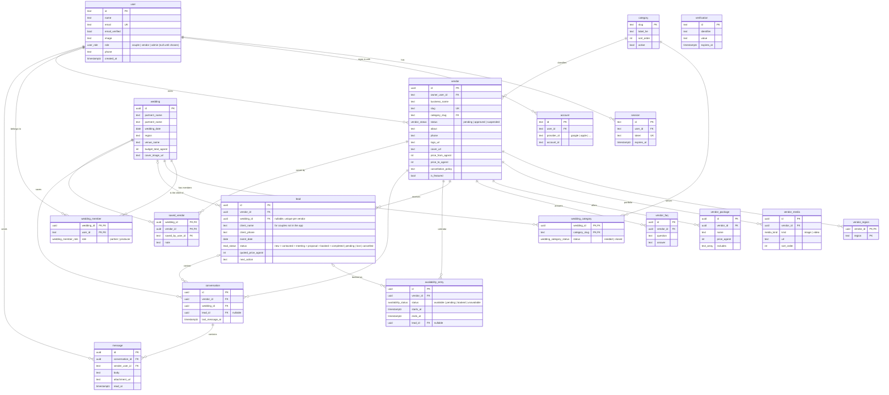
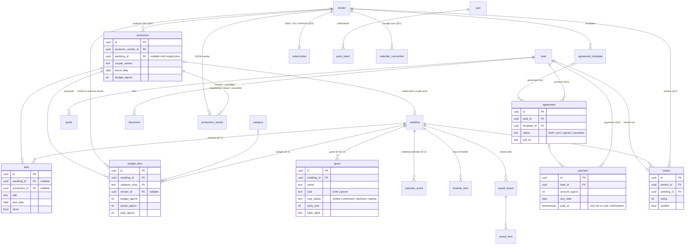

# SOON — Entity Relationship Diagram

Source of truth is the Drizzle schema in [`apps/server/src/db/schema`](../apps/server/src/db/schema).
Update this file whenever the schema changes.

**Conventions**
- Money is stored as integer **agorot** (`*_agorot`, 1 ₪ = 100).
- `user` / `session` / `account` / `verification` are owned by Better Auth.
- A **wedding is not a user**. Partners (and later a producer) are linked through `wedding_member`.
- A **lead** points to a registered `wedding` *or* holds contact details for a couple who isn't in the app.
- Booked slots on a vendor's calendar cannot overlap. A Postgres `EXCLUDE` constraint enforces this.

---

## 1. Schema v1: trial scope (built)

**Key constraints**

| Table | Constraint | Why |
|---|---|---|
| `lead` | `UNIQUE (vendor_id, wedding_id)` | One lead per couple per vendor. A repeat inquiry reuses it. |
| `lead` | `CHECK (wedding_id IS NOT NULL OR client_name IS NOT NULL)` | A lead must identify a client. |
| `conversation` | `UNIQUE (vendor_id, wedding_id)` | One chat thread per couple–vendor pair. |
| `availability_entry` | `EXCLUDE ... WHERE status = 'booked'` | No double-booking. |
| `vendor` | `CHECK (price_from <= price_to)` | A valid price range. |

---

## 2. Planned entities: after the trial (not built yet)

These come from spec §19. Entities without a field list (`wedding`, `vendor`, `lead`, `category`, `user`) are the v1 tables above. Field lists are indicative.

> **Design note:** `task` and `budget_item` belong to either a wedding or a production. When a couple joins a producer's production, the production's `wedding_id` is set, and both sides then see the same rows according to their permissions. Nothing is copied (spec §14.3, §20).
